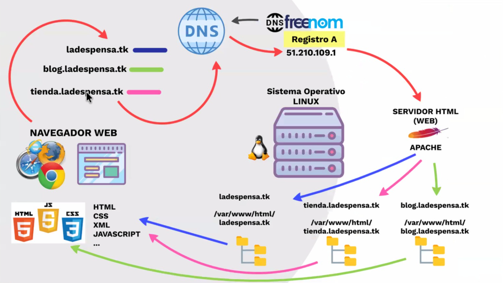
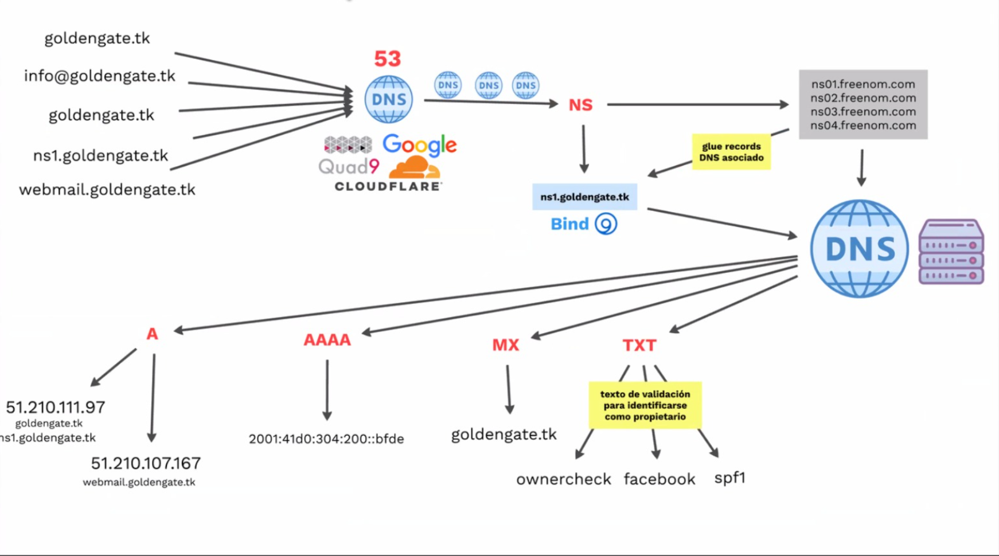
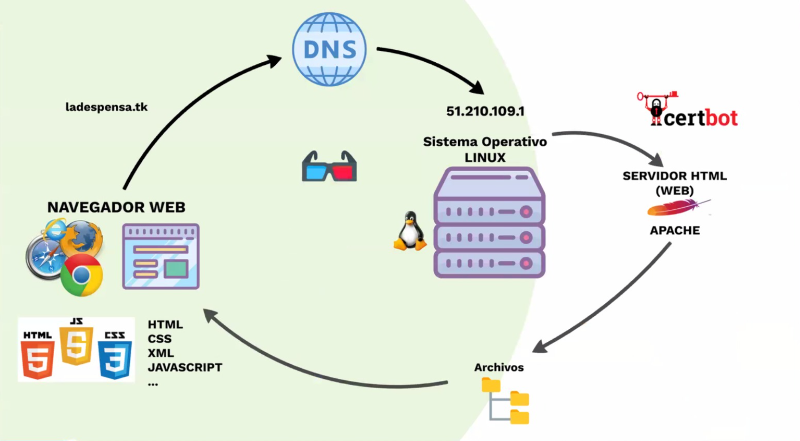

# SER · Repaso del trimestre y simulacro (17/11)

> Anterior: [Clase 9 (10/11): HTTPS con Certbot y segundo CMS](2026-11-10_clase9-https-certbot-moodle.md) · Profesor: Damián Sualdea Soy

Clase de repaso, sin contenido nuevo. El profesor explica cómo será el **simulacro**, qué tema entra y cómo, y enseña **tres dibujos** que hay que saber hacer y explicar. Esta nota está organizada por lo que te van a pedir (dibujar, leer ficheros, explicar comandos, teoría de test) y no por el orden de la clase. La práctica con soluciones al final.

Convención: **(clase)** = audio, **(temario)** = PDF oficial, **(lab)** = notas de laboratorios anteriores, **(mío)** = añadido por mí, **(notas de Dani)** = tu lista.

## Lo imprescindible

> [!important] Cómo es el simulacro (clase)
> - **Test de 15 preguntas**, **preguntas cortas** ("explicar cosas muy concretas") y **casos prácticos**; en los casos prácticos **hay que dibujar**.
> - **Lo que siempre cae:** (1) **leer una zona DNS**, (2) **leer un virtual host**, (3) **explicar comandos** que te pone "tal cual", (4) **dibujar** el servicio con una explicación breve debajo.
> - **Solo hay dos servicios prácticos: DNS (BIND9) y servidor web (Apache).** DHCP solo en teoría (el DORA).
> - Se corrige **por elementos y conexiones, no por el arte**: "con los dibujitos y con los cuadrados me vale".
> - Tendrás una **hoja con comandos básicos** (la imprime él en el examen): no hay que memorizarlos, hay que saber **cuál usar** ("me ha caído virtual host, pues para activarlo es `a2ensite`").
> - **Simulacro publicado el viernes 20/11** en el foro; se trabaja **en la próxima clase** y **no hay nada que subir** (puedes hacerlo antes y comparar con él). En el propio simulacro "está puesto lo que voy a preguntar".

> [!warning] El examen de mayo (clase, sin más detalle)
> El profesor dice que el examen final "es un examen muy divertido y muy fácil", "practiquillo", con dibujos, lectura de configuración y comandos. No dio estructura ni nota por parte (**sin confirmar**). Tampoco dijo si el formato es en papel (insinúa que sí: "yo lo voy a imprimir en el examen").

## Qué entra por tema (y cómo se contrasta con tu lista)

| Tema | Lo que dijo el profesor (audio) | Tu lista | Qué ajustar |
|---|---|---|---|
| **1 (1.1-1.6)** | "La parte que menos toco". Solo **test**. Puertos (reservados 0-1023, registrados, dinámicos), NAT (dinámico y PAT, "sobrecargado"), **TCP vs UDP** (importante saber diferenciarlo), modelo **TCP/IP de 4 capas**; "en todo caso las capas del OSI". **No** le interesan topologías ni tipos de redes | Puertos ✓; NAT estático/dinámico/PAT ✓; TCP/UDP "3 handshake, velocidad, características"; modelos "TCP/IP el más importante"; IPv4, IPv6 | El *handshake* de 3 pasos **no se dijo** hoy y **tampoco está** en el Tema 1 del temario (mío: SYN, SYN-ACK, ACK; si cae, es de test). IPv4/IPv6 **no salió** en el audio (sí está en 1.5). Sobre los modelos hay un mensaje doble: "si os aprendéis una, aprended TCP/IP" pero también "no lo suelo preguntar en el final de mayo" y cierra con "TCP/UDP y las capas del OSI". **Estudia los dos** |
| **2 (completo)** | **Solo el DORA**: "qué es el DORA, sin más, no nos complicamos la vida". Montó DHCP en AWS pero "no me gusta"; **"no hay configuración ninguna"** | "DORA, configuración, poco más; conceptos: ámbito, etc." | **"Configuración" no va:** dijo expresamente que no pondrá configuración de DHCP. "Ámbito" **no se dijo** hoy; está en 2.5 del temario, así que es material de test posible, no de práctica |
| **3 (3.1-3.9)** | "Servicio importante, me gusta mucho". **Dibujo del DNS**; **zona directa e inversa**; registros **A, AAAA, NS, CNAME, MX, TXT y PTR**; `@`; **TLD** ("lo leéis por encima", test); principal/secundario y transferencia de zona; `host` y `dig` | DNS completo; host/dig; dibujo; directa e inversa; registros A, AAAA, TXT, MX, CNAME, `@`; TLD; tipos de servidores | **Te faltan NS y PTR** (el profesor los nombró; PTR es la zona inversa). Añade **`named-checkzone`** a los comandos |
| **4 (4.1-4.6)** | **Dibujo de cómo atiende Apache una petición**; dónde publica por defecto (`/var/www/html`), **80 y 443**, **virtual hosts** ("me parece superimportante"), `ServerName` y `DocumentRoot` ("no hay más"), métodos y códigos (GET/POST/PUT; 404, 503, 301), **HTTPS** (concepto y dibujo) | Dibujo; rutas de configuración, hosts, puertos; virtual hosts; HTTPS con Certbot | Añade **`ServerName` + `DocumentRoot`** como las dos directivas clave. **Autenticación básica (`htpasswd`): "lo tenéis como ejercicio, pero no os entra"**. Ojo: el apartado **4.6 del temario** trata autenticación/autorización/control de acceso como concepto; que la práctica no entre no descarta una pregunta de test (mío) |

> [!note] Los rangos de apartados
> Solo el del Tema 1 ("de la 1.1 a la 1.6") se oye en el audio; el resto de frases sobre "las clases 2 y 3 con el laboratorio" salen rotas. Los rangos de los Temas 2-4 coinciden con "todo salvo las referencias bibliográficas" (mío: 3.10 y 4.7 son referencias), pero **no se confirmó** si los Entrenamientos de cada tema entran.

## Dibujo 1 · Servidor web con virtual hosts (Apache)



Es "el dibujo del servidor web". Por colores (azul = dominio, verde = `blog`, rosa = `tienda`) se ve que **los tres nombres acaban en la misma IP** y que es **Apache** quien los reparte a carpetas distintas.

**Cómo se lee (clase):**
1. En el **navegador** escribes un nombre (`ladespensa.tk`, `blog.ladespensa.tk`, `tienda.ladespensa.tk`).
2. El **DNS** lo resuelve a una IP mediante el **registro A** (`51.210.109.1` en el dibujo). Los tres nombres llevan a **la misma IP**.
3. La IP es la del **servidor Linux** con **Apache** (puerto **80**, o **443** con HTTPS).
4. Apache mira **con qué nombre llegó la petición** (`ServerName`) y la manda a la carpeta de ese sitio (`DocumentRoot`): `/var/www/html/ladespensa.tk`, `/var/www/html/tienda.ladespensa.tk`, `/var/www/html/blog.ladespensa.tk`.
5. Esas carpetas contienen los archivos (**HTML, CSS, XML, JavaScript**...) que viajan de vuelta al navegador, que los interpreta.
6. Lo que pide el navegador son **métodos** (GET, POST, PUT) y lo que devuelve el servidor son **códigos de estado** (404, 503, 301...). Un `curl` normal es un GET.

**Plantilla de explicación para escribir debajo (5-6 líneas):**
> El navegador pide `blog.dominio`; el DNS lo resuelve con un registro A a la IP del servidor; la petición llega al puerto 80/443 donde Apache está escuchando; Apache compara el nombre pedido con el `ServerName` de cada virtual host y sirve los ficheros de su `DocumentRoot`. Así una sola IP y un solo Apache atienden varios sitios, uno por nombre.

> [!note] Dos matices (mío)
> - En el dibujo la flecha va DNS → IP → Apache. **En rigor** el DNS devuelve la IP **al navegador** y es el navegador quien conecta con el servidor. Dibuja lo del profesor y, si quieres, aclara la secuencia en la explicación.
> - El profesor dijo que "faltaría poner el `.com`" (los nombres reales de tu dominio). Usa en el examen los nombres que te pidan, no los `.tk` del dibujo.

**Esqueleto para dibujar en un minuto:**

```
Navegador ──(1) ¿blog.dom?──▶ DNS ──(2) A: <IP>──▶ (vuelve al navegador)
Navegador ──(3) GET, puerto 80/443──▶ Servidor Linux <IP> + Apache
                                        │ lee el nombre → ServerName
                                        ├─ dom        → /var/www/html/dom
                                        ├─ blog.dom   → /var/www/html/blog.dom
                                        └─ tienda.dom → /var/www/html/tienda.dom
Apache ──(4) HTML/CSS/JS + código 200──▶ Navegador
```

## Dibujo 2 · DNS propio con BIND9



El dibujo muestra **quién pregunta** (arriba a la izquierda), **quién delega** (el registrador) y **quién responde** (tu BIND9 con la zona).

**Elementos y conexiones (clase + lo que se ve en el dibujo):**
1. **Nombres que se preguntan:** `goldengate.tk`, el correo `info@goldengate.tk`, `ns1.goldengate.tk`, `webmail.goldengate.tk`. Todos entran por el **puerto 53**.
2. **Resolvedores públicos** (Google, Quad9, Cloudflare): son los DNS "a nivel global" que usa tu equipo para resolver. El profesor explica por qué aparecen: por defecto tu ordenador usa sin querer el `8.8.8.8` de Google o el DNS del router de tu operadora; recomienda poner **Quad9** (el "seguro") o **Cloudflare (`1.1.1.1`)**, en el equipo o en el router.
3. **Registro NS en el registrador:** por defecto apunta a los DNS del propio registrador (`ns01…ns04.freenom.com` en el dibujo; en tu caso Namecheap o IONOS).
4. Para **usar tu propio DNS** se cambia el NS a **`ns1.tu-dominio`** y se da de alta un **glue record** (en el dibujo "DNS asociado"; cada registrador le pone su propio nombre en el panel, **sin confirmar** cuál usa el tuyo): es **la IP del propio `ns1`**, necesaria porque `ns1.tu-dominio` está dentro del dominio que tiene que resolver. Sin la IP, el nombre del servidor no se podría encontrar (mío: razonamiento; el temario no usa el término).
5. **Servidor BIND9** (`ns1`), escuchando en el **53**. "Cuando alguien pregunte de cualquier cosa, en vez de irte a Namecheap, te vas al DNS que hemos creado en BIND9": nosotros somos **dueños del DNS de nuestro dominio** y ponemos los registros que queramos.
6. **Registros de la zona** en el dibujo: **A** (nombre → IPv4; `goldengate.tk` y `ns1` a una IP y `webmail` a otra), **AAAA** (IPv6), **MX** (dónde va el correo; apunta a un nombre), **TXT** (texto de verificación de propiedad; en el dibujo `ownercheck`, `facebook`, `spf1`).

> [!important] Lo que el profesor dijo que "falta" en el dibujo
> Preguntó qué le faltaba al dibujo y se respondió él mismo: el **NS** sí está; **falta el CNAME** (alias a otro nombre) y, para la zona inversa, el **PTR**. Si te piden un dibujo completo, añádelos.

**Plantilla de explicación (5-6 líneas):**
> Instalo BIND9 en un servidor con IP fija (puerto 53 abierto) y declaro la zona directa y la inversa. En el registrador cambio los servidores de nombres al mío (`ns1.dominio`) y creo el glue record con su IP. Cuando un cliente pregunta a su resolvedor por `www.dominio`, la consulta llega a mi BIND9, que responde con el registro de la zona (A, AAAA, MX, TXT...). Compruebo con `named-checkzone`, `host` y `dig`.

> [!note] Dos datos sueltos (clase, sin confirmar)
> - Actualmente se suelen **exigir dos NS** (principal y secundario); "hace 4 o 5 años" bastaba uno. **Sin confirmar** si lo impone cada registrador. El **secundario** solo **replica** (redundancia) y se sincroniza con el principal mediante **transferencia de zona (AXFR)**; el profesor dijo que montarlo no cabe en una clase de hora y media.
> - Para el examen **no** hay que montar secundarios: basta saber qué son (ver tabla de tipos de servidores más abajo).

**Esqueleto:**

```
Cliente ─(1) ¿www.dom?─▶ Resolvedor público (8.8.8.8 · 9.9.9.9 · 1.1.1.1)
Resolvedor ─(2) ¿quién lleva dom?─▶ (raíz → TLD) → NS de dom: ns1.dom (+ glue: IP de ns1)
Resolvedor ─(3) ¿www.dom? (puerto 53)─▶ BIND9 en ns1.dom
BIND9 (zona): A · AAAA · MX · TXT · NS · CNAME · PTR ─(4) respuesta─▶ Resolvedor ─▶ Cliente
```

## Dibujo 3 · HTTPS con Certbot



Es **el mismo ciclo del dibujo 1** (navegador → DNS → IP → Linux → Apache → archivos → navegador) con **Certbot** añadido junto a Apache. El profesor **no explicó el icono de las gafas 3D** (**sin confirmar** qué quiere decir; es probable que simbolice que nadie puede "ver" la comunicación, pero no lo dijo).

**Qué explicar (clase):**
1. **Certbot** se instala en el servidor y **obtiene un certificado** de una autoridad (en tus prácticas, Let's Encrypt; el profesor dijo que "eso va cambiando").
2. El certificado se **instala en Apache**: aparece un **virtual host nuevo** (el del **puerto 443**, fichero acabado en `-le-ssl.conf`) que **carga el certificado**. En el del 80 se añade una **redirección a HTTPS** (el profesor la vio como una línea `RewriteRule` "abajo").
3. A partir de ahí **toda la comunicación navegador ↔ servidor va cifrada**.
4. Lo que se consigue es meter **SSL/TLS** en la comunicación (ver matiz abajo).

**SSL y TLS (clase, con correcciones mías):**

| Término | Qué es | Notas |
|---|---|---|
| **SSL** (*Secure Sockets Layer*) | Versiones 2.0 y 3.0 | **Obsoleto e inseguro** |
| **TLS** (*Transport Layer Security*) | Sucesor de SSL; el que se usa hoy (el profesor citó la **1.3**) | La gente sigue diciendo "SSL" por costumbre |

> [!warning] Dos imprecisiones del profesor (mío, de memoria; no contrastado con fuente en esta sesión)
> - Dijo que SSL "se reventó" por una herramienta de *man in the middle* tipo **SSLstrip**. SSLstrip es un ataque de **degradación** (hace que la víctima use HTTP en vez de HTTPS), no lo que condenó a SSL; los SSL 2.0/3.0 se abandonaron por **debilidades del propio protocolo**.
> - Dijo que TLS "sube a nivel de transporte". En el modelo TCP/IP, TLS va **encima de TCP** y por debajo de HTTP; "Transport" está en el nombre, pero no es un protocolo de la capa de transporte.
> Para el test, quédate con **SSL = antiguo e inseguro, TLS = actual**.

**Comandos de Certbot** (ya en la [Clase 9](2026-11-10_clase9-https-certbot-moodle.md)): `sudo apt install -y certbot python3-certbot-apache` → `sudo certbot --apache -d <dominio> -d www.<dominio> ...` → `sudo certbot renew --dry-run`. Requisito: **443 abierto** en el Security Group.

**Esqueleto:**

```
Navegador ─ https://dom ─▶ DNS ─ A ─▶ <IP> ─▶ Linux + Apache  ◀── Certbot (pide e instala el certificado)
                                       │ VirtualHost :443 (-le-ssl.conf) con certificado
                                       │ VirtualHost :80  → redirige a https
Archivos (HTML/CSS/JS) ─ cifrados con TLS ─▶ Navegador
```

## Leer ficheros de configuración (lo que siempre cae)

### Zona DNS

El profesor puso como ejemplo una zona con estas líneas (las IP no se oyen bien: aquí van como marcadores). Escribe y lee cada una en voz alta:

```
@        IN A      <IP>                          ; el dominio, a una IP
blog     IN A      <IP>                          ; blog.desplegando123.com → IP
aula     IN A      <IP>                          ; aula.desplegando123.com → IP
www      IN CNAME  desplegando123.com.           ; alias: apunta a un NOMBRE, no a una IP
@        IN MX 10  mail.desplegando123.com.      ; correo del dominio; 10 = prioridad
```

| Línea | Qué dice |
|---|---|
| `@ IN A <IP>` | `@` = el propio dominio de la zona. Registro **A**: nombre → **IPv4** |
| `blog IN A`, `aula IN A` | Subdominios `blog.dominio` y `aula.dominio` → esa IP |
| `www IN CNAME dominio.` | **Alias**: `www` apunta a **otro nombre**. Se pone un **dominio, no una IP** |
| `@ IN MX 10 mail.dominio.` | **Correo**: el servidor que lo recibe; el número es el **peso/prioridad** (menor = antes; vale 10, 20, 30...) |
| El punto final de `dominio.` | **Muy importante**: sin él, BIND añade el nombre de la zona detrás |

> [!important] El fallo que plantea el profesor
> El **MX apunta a `mail.desplegando123.com.`, pero ese nombre no existe** en la zona: **falta el registro A de `mail`**. "Como no existe, se vuelve loco." **Arreglo:** añadir `mail IN A <IP>` (él lo pondría **debajo de `aula`**). Dijo expresamente que el **TXT no es lo que falta**.

Las líneas de **SOA** y **NS** de la cabecera (el profesor dijo que "te pongo entero, no 4 líneas") están explicadas en el [Laboratorio 3](2026-10-21_laboratorio3-dns-bind9.md): serial, refresh, retry, expire, TTL mínimo, y el NS con el A del propio `ns`. En la **zona inversa** cada host lleva un **PTR** con el final de la IP **del revés** (y el nombre de la zona lleva los octetos de red al revés): `218.10 IN PTR ns.dominio.`; el número de octetos lo marca la máscara (lab: `/16` → 2).

### Virtual host

Lo que hay que reconocer y poder escribir (plantilla de [Clase 8](2026-11-03_clase8-dns-actividad1-apache-virtual-hosts.md), con la ruta de la guía):

```apache
<VirtualHost *:80>
    ServerName    tienda.desplegando123.com
    DocumentRoot  /var/www/html/tienda.desplegando123.com
</VirtualHost>
```

| Qué | Qué significa |
|---|---|
| `ServerName` | **El dominio con el que llega la petición**; lo que identifica el sitio |
| `DocumentRoot` | **A qué carpeta se manda** ese dominio; tiene que **existir** y llevar un `index.html` |
| Un fichero + una carpeta por sitio | En `/etc/apache2/sites-available/`; se activa con `a2ensite` y `systemctl reload apache2` |
| `*:80` / `*:443` | Puerto de la petición (HTTP / HTTPS) |
| `ServerAlias www.dominio` | (Clase 9) para que `www` caiga en el mismo sitio, porque el navegador envía el nombre tal cual lo escribes |

> [!important] Lo que el profesor repitió
> "**`ServerName` y `DocumentRoot`: no hay más.** El `ServerName` identifica el dominio con el que viene; el `DocumentRoot`, a qué parte de mi carpeta le mando." **Apache publica por defecto en `/var/www/html`** (el virtual host por defecto es `000-default`).

**Si la plantilla incluye HTTPS (mío, lo que suele generar Certbot; comprueba el tuyo):** el sitio del **443** (`…-le-ssl.conf`) lleva `<VirtualHost *:443>` con `SSLCertificateFile` y `SSLCertificateKeyFile` (rutas bajo `/etc/letsencrypt/live/<dominio>/`: `fullchain.pem` y `privkey.pem`), y el del 80 gana una **redirección a `https://`** (`RewriteRule`).

**Moodle (clase):** su carpeta de datos (`moodledata`) **nunca** puede estar en la parte pública de Apache; "la metes para atrás". Es un requisito de Moodle, no de Apache.

## Comandos (la hoja que te darán)

El profesor insiste: **no te aprendas los parámetros de memoria** ("yo nunca me aprendo los parámetros"). Pasa el comando a `man <comando>` y mira las opciones. Lo que sí hay que saber es **qué comando resuelve cada pregunta**.

| Si te piden... | Comando | Origen |
|---|---|---|
| Instalar el DNS | `sudo apt install bind9` | (clase; el laboratorio usa además `bind9-utils bind9-dnsutils`) |
| Instalar el servidor web | `sudo apt install apache2` | (clase) |
| Declarar las zonas | `/etc/bind/named.conf.local` | (clase y lab) |
| Comprobar una zona antes de reiniciar | `named-checkzone <zona> <fichero>` | (lab; en el audio sale roto: "bit name check of…") |
| Comprobar la configuración de BIND | `named-checkconf` | (lab) |
| Reiniciar el DNS / recargar Apache | `sudo systemctl restart named` · `sudo systemctl reload apache2` | (clase y lab) |
| Preguntar al DNS | `host <nombre>` · `host -t NS\|MX\|A\|TXT <dominio>` | (clase) |
| Preguntar con detalle o la respuesta corta | `dig <nombre>` · `dig <nombre> +short` | (clase: "dig short") |
| IP → nombre | `dig -x <IP>` · `host <IP>` | (lab) |
| Activar / desactivar un virtual host | `sudo a2ensite <sitio>.conf` · `sudo a2dissite <sitio>.conf` | (clase) / (mío) el segundo |
| Módulos de Apache | `a2enmod` / `a2dismod`; `mods-available` y `mods-enabled` | (clase, "no es importante, no lo hemos visto") |
| Una petición web sin navegador | `curl -I <url>` (cabeceras y código) · `curl -v <url>` | (lab; el profesor dijo "curl con una opción" y el audio no deja ver cuál) |
| HTTPS | `sudo certbot --apache -d <dominio> ...` | (clase 9) |

Rutas que debes poder situar: `/etc/bind/` (`named.conf.local`, ficheros de zona `db.*`), `/etc/apache2/sites-available/` y `sites-enabled/` (enlaces simbólicos a los activos), `/var/www/html/` (donde publica Apache), `/etc/letsencrypt/live/<dominio>/` (certificados, mío).

> [!note] Un comando que el profesor dijo y no entiendo del audio
> Al hablar de `host` y `dig` dijo "y en ese lugar..." (**sin confirmar**; es probable que sea `nslookup`, que ya salió en el laboratorio de Windows).

## Hoja de respuestas de teoría (test y preguntas cortas)

### Tema 1 (solo test)

| Concepto | Respuesta corta |
|---|---|
| Puertos | **0-1023** bien conocidos/reservados (IANA); **1024-49151** registrados; **49152-65535** dinámicos o efímeros. El **servidor** escucha en un puerto fijo (80, 53...); el **cliente** sale por uno dinámico (temario 1.2, clase) |
| Puertos comunes | 80 HTTP · 443 HTTPS · 53 DNS · 21 FTP · 25 SMTP (temario); 22 SSH y 67/68 DHCP ((lab) 29/09) |
| NAT | Cambia la IP privada por la pública en el router. **Estático**: una privada ↔ una pública. **Dinámico**: una privada ↔ una de un conjunto de públicas. **PAT** (NAT sobrecargado): muchas privadas con **una** pública, distinguidas por el **puerto** (el más común en casa) |
| TCP | Orientado a conexión, **fiable y ordenado**, más lento. Lo usan HTTP, HTTPS, FTP, SMTP (clase) |
| UDP | **Sin conexión**, no garantiza la entrega, **más rápido**. Lo usan **DNS** (consultas) y el **streaming** (clase) |
| Modelo TCP/IP (4 capas) | **Aplicación**, **transporte**, **Internet** (IP), **acceso a la red**. Ejemplos de la clase: HTTP/SMTP/Telnet/FTP en aplicación; TCP y UDP en transporte |
| Modelo OSI (7 capas) | Aplicación, presentación, sesión, transporte, red, enlace de datos, física |
| IPv4 / IPv6 | 32 bits en 4 octetos (≈4.300 millones) / 128 bits en 8 grupos hexadecimales (temario 1.5) |

> [!warning] Matiz sobre DNS y UDP (mío)
> "DNS va por UDP" es la respuesta para el test, pero el DNS usa **TCP en las transferencias de zona** (`dig axfr`, visto en el [Laboratorio 3](2026-10-21_laboratorio3-dns-bind9.md), por eso se abren el 53 UDP **y** TCP).

### Tema 2 (DHCP)

- **DORA**: **D**iscover → **O**ffer → **R**equest → **A**cknowledge (clase: "discover, offer, request y ACK"). El cliente parte sin IP (0.0.0.0) y manda el Discover por difusión; el servidor ofrece, el cliente solicita la oferta y el servidor confirma (temario 2.7).
- Conceptos del temario (2.5) por si aparecen en test: **ámbito** (conjunto de IP que gestiona), **rango**, **exclusiones**, **tiempo de concesión** (*lease*), **reservas** (IP fija por MAC).

### Tema 3 (DNS)

| Registro | Para qué |
|---|---|
| **A** / **AAAA** | Nombre → IPv4 / IPv6 |
| **NS** | Qué servidores de nombres tienen autoridad sobre la zona |
| **CNAME** | Alias: un nombre que apunta a **otro nombre** |
| **MX** | Servidor de correo del dominio, con prioridad |
| **TXT** | Texto libre; verificaciones de propiedad (el profesor: "texto de verificación"), SPF... |
| **PTR** | Resolución **inversa**: IP → nombre; vive en la **zona inversa** |
| **SOA** | Datos de la zona: servidor primario, contacto, serial y temporizadores |

| Servidor DNS (temario 3.5) | Qué hace |
|---|---|
| **Principal (master)** / **secundario (slave)** | Tiene la zona original / guarda una **copia** (redundancia y reparto de carga) |
| **Autoritativo** / **no autoritativo** | Responde con datos **propios** de la zona / **no** tiene el original y consulta a otros |
| **Recursivo** | Hace **todo el proceso** de resolución por el cliente |
| **Caché** | Guarda respuestas recientes |
| **Reenvío (forwarding)** | Manda todas las consultas a otro servidor |
| **Raíz (root)** | **13** (letras **A a M**); conocen a los TLD |
| **TLD** | Gestiona los dominios de **nivel superior** (`.com`, `.org`, `.net`; (mío) también los de país como `.es`) |
| **Zona inversa** | Resolución IP → nombre |

- **Zona directa** = nombre → IP (registros A, AAAA, CNAME, MX, TXT...). **Zona inversa** = IP → nombre (registros PTR).
- `@` = el propio dominio de la zona. Todo nombre completo acaba en **punto**.
- **TLD** (clase): los dominios del nivel inmediatamente debajo de la raíz.

> [!warning] Dos fallos de fuentes (mío)
> - El profesor, hablando de los servidores raíz, dijo "de la A a la G o la H, no me acuerdo". **El temario (3.5) dice 13, de la A a la M**: esa es la respuesta.
> - El temario (3.7) **lista `DHCPRELEASE` entre los tipos de registro de recursos**. **No es un registro DNS**: es un mensaje de DHCP. No lo incluyas como tipo de registro.

### Tema 4 (web)

- **Servidor web (Apache)**: sirve los archivos del sitio por **HTTP (80)** o **HTTPS (443)**.
- **Sitio virtual** (temario 4.5): un solo servidor web aloja **varios sitios**. Se identifican **por nombre** (el más popular; exige DNS bien configurado), **por puerto** o **por IP**. En la asignatura: **por nombre**.
- **Acceso (temario 4.6)**: autenticación (anónima, básica, digest...), autorización y control de acceso.
- **Códigos de estado** (clase): 404, 503, 301... (más en la [nota del 27/10](2026-10-27_correcciones-lab3-dns-e-intro-servidor-web.md)). **Métodos**: GET, POST, PUT (en el 27/10 también HEAD).

## Dudas y cosas sin confirmar

- **Número y reparto de preguntas:** se dijo "test de 15 preguntas", más preguntas cortas y casos prácticos, sin nº ni nota por parte. Tiempo y formato del examen final, **sin confirmar**.
- **Qué lleva tu hoja de comandos:** dijo que "voy a imprimir en el examen" una lista; no dijo si la del simulacro es la misma.
- **Rangos de apartados de los Temas 2, 3 y 4:** vienen de tus notas (no se oyen).
- **"La parte de seguridad":** hacia el final dijo que "nos falta la parte de seguridad" (Tema 7 del temario). **No quedó claro** si entra en el simulacro; por lo que dijo del resto, es probable que no.
- **Certificados:** al hablar de HTTPS mencionó un ejercicio con un certificado "firmado por nosotros" y otro firmado por Let's Encrypt ("red sin creed" en el audio roto) para verlos con más calma "en otro apartado"; **sin confirmar** cuándo.
- **Icono de las gafas 3D** del dibujo 3: no explicado.

## Logística y para llevar a casa

- **Viernes 20/11:** el simulacro estará en el foro. No hay entrega. Puedes hacerlo antes de verlo con el profesor ("podéis tenerlo hecho y luego verlo conmigo, o hacerlo en clase").
- **La Actividad 1 de SER vencía el 16/11** (ayer). En esta clase no se oye ninguna prórroga ni nueva fecha. Si no la has entregado, compruébalo en el campus.
- **Para el simulacro:** dibuja de memoria los **tres dibujos** con su explicación de 5-6 líneas; practica **leer una zona y un virtual host** (ejercicios 20-24); repasa los **Temas 1-4** con la hoja de respuestas y la práctica.
- **Consejo del profesor sobre las actividades:** ir haciéndolas **poco a poco con capturas**, no "del tirón".
- El profesor dijo que publicará el simulacro, "lo importante" y las grabaciones de las clases 9 y 10 en el foro: **cuando lleguen, completa** esta nota (sobre todo la lista exacta de apartados).

---

# Práctica para el simulacro

> Primero los ejercicios; **las soluciones están al final**. Haz cada nivel sin mirar la hoja de respuestas.

## Nivel 1 · Test y respuesta de una línea

1. ¿Qué rango de puertos son los "bien conocidos"? ¿Qué tipo de puerto usa tu navegador para salir hacia un servidor?
2. Un router con **una** IP pública da Internet a 20 ordenadores. ¿Qué tipo de NAT es?
3. Diferencia entre NAT **estático** y NAT **dinámico**.
4. ¿Por qué protocolo de transporte van normalmente las consultas **DNS**? ¿Y las páginas web?
5. Nombra las **4 capas** del modelo TCP/IP y di en cuál están HTTP, TCP e IP.
6. Ordena los mensajes del **DORA** y di qué significa cada letra.
7. ¿Qué registro DNS usarías para: (a) nombre → IPv4, (b) nombre → IPv6, (c) un alias, (d) el servidor de correo, (e) IP → nombre, (f) un texto de verificación, (g) qué servidores llevan la zona?
8. ¿Qué es un **TLD**? Pon dos ejemplos.
9. Diferencia entre un servidor DNS **autoritativo** y uno **recursivo**.
10. ¿En qué puertos escucha un servidor web HTTP y HTTPS, y en qué carpeta publica Apache por defecto?
11. ¿Cuántos servidores DNS raíz hay y qué letras llevan?
12. ¿Qué es un **PTR** y en qué zona se escribe?

## Nivel 2 · Preguntas cortas (4-6 líneas, a mano)

13. Explica qué es un **virtual host por nombre** y por qué permite varias webs con una sola IP.
14. Describe qué pasa desde que escribes `blog.midominio.com` en el navegador hasta que ves la web (sin dibujo).
15. ¿Para qué sirve un **glue record** y cuándo hace falta?
16. Diferencia entre **zona directa** y **zona inversa**, y qué registros lleva cada una.
17. ¿Qué hace **Certbot** y qué tienes que tener abierto en el servidor para que funcione?
18. ¿Por qué el servidor DNS de un dominio suele tener **un secundario**? ¿Cómo se sincronizan?
19. ¿Qué diferencia hay entre SSL y TLS? ¿Cuál se usa hoy?

## Nivel 3 · Casos prácticos

### Caso A · Leer una zona (la IP es un marcador de documentación)

```
$TTL 3600
@        IN SOA ns.tuweb.com. admin.tuweb.com. (
              2026111701 7200 3600 1209600 86400 )
@        IN NS    ns.tuweb.com.
ns       IN A     203.0.113.10
@        IN A     203.0.113.10
tienda   IN A     203.0.113.10
www      IN CNAME tuweb.com
@        IN MX 10 correo.tuweb.com.
@        IN TXT   "v=spf1 a mx -all"
```

20. Explica qué hace **cada línea**.
21. Encuentra **dos errores** y di cómo se arreglan.

### Caso B · Leer un virtual host

```apache
<VirtualHost *:80>
    ServerName    shop.tuweb.com
    DocumentRoot  /var/www/html/shop.tuweb.com
</VirtualHost>
```

22. ¿Qué petición atiende este bloque? ¿Qué carpeta se sirve?
23. ¿Qué pasos faltan para que **funcione**, en Apache y en el DNS?
24. ¿Qué verá el usuario si la carpeta `DocumentRoot` **no existe**?

### Caso C · Explicar comandos (te los darán tal cual)

25. Di qué hace cada uno y para qué lo usarías:
   - `sudo named-checkzone tuweb.com /etc/bind/db.tuweb.com`
   - `dig @203.0.113.10 tuweb.com MX +short`
   - `host -t txt tuweb.com`
   - `sudo a2ensite shop.tuweb.com.conf && sudo systemctl reload apache2`
   - `curl -I http://shop.tuweb.com`
   - `sudo certbot --apache -d tuweb.com -d www.tuweb.com`

### Caso D · Dibujos (a mano, con explicación de 5-6 líneas)

26. **Dibujo 1:** un servidor web con **tres sitios** (principal, `blog`, `tienda`) en una sola IP.
27. **Dibujo 2:** un **DNS propio con BIND9** para un dominio, con la delegación en el registrador y los registros A, AAAA, MX y TXT.
28. **Dibujo 3:** el mismo servidor web con **HTTPS** mediante Certbot.

### Caso E · Integrador

29. Tienes el dominio `miempresa.com` comprado en un registrador y una máquina Linux con IP fija. Quieres: web en `miempresa.com`, un `blog.miempresa.com` y correo propio. **Ordena** todo lo que harías (DNS, Apache, virtual hosts, HTTPS) y qué comprobarías en cada paso.

---

## Soluciones

> No mires aquí antes de haber intentado los ejercicios.

**Nivel 1**

1. **0-1023**. El navegador sale por un **puerto dinámico** (efímero, 49152-65535); el servidor escucha en uno fijo.
2. **PAT** (NAT sobrecargado, muchos a una por puertos).
3. Estático: una IP privada ↔ **una** pública concreta (para un equipo que necesita IP pública fija). Dinámico: una privada se asocia a **una de un conjunto** de públicas.
4. DNS: **UDP 53** (en las consultas normales; las transferencias de zona van por TCP). Web: **TCP**.
5. Aplicación (**HTTP**), transporte (**TCP**), Internet (**IP**), acceso a la red.
6. **Discover** (cliente busca servidores), **Offer** (el servidor ofrece una configuración), **Request** (el cliente la pide), **Acknowledge** (el servidor confirma).
7. (a) A, (b) AAAA, (c) CNAME, (d) MX, (e) PTR, (f) TXT, (g) NS.
8. Dominio de **nivel superior**, justo debajo de la raíz: `.com`, `.org`, `.net`, `.es`...
9. **Autoritativo**: tiene la información **original** de la zona y responde por ella. **Recursivo**: hace por el cliente **todo el proceso** consultando a otros hasta tener la respuesta.
10. **80** y **443**; `/var/www/html`.
11. **13**, letras **A a M**.
12. Registro de **resolución inversa** (IP → nombre); va en la **zona inversa**.

**Nivel 2** (modelos de respuesta; ajusta a tus palabras)

13. Un **virtual host por nombre** es una configuración de Apache que asocia un `ServerName` a un `DocumentRoot`. Todos los nombres apuntan por DNS a la misma IP; Apache mira con qué nombre llegó la petición y sirve la carpeta de ese sitio. Así **una IP y un Apache** atienden varias webs.
14. El navegador pide la IP de `blog.midominio.com` a su resolvedor; este llega al servidor que lleva la zona y responde con el registro **A**. El navegador conecta a esa IP (80/443); Apache lee el nombre pedido, elige el virtual host con ese `ServerName` y devuelve los ficheros del `DocumentRoot`.
15. Cuando el servidor DNS de tu dominio está **dentro del propio dominio** (`ns1.midominio.com`): el registrador debe conocer la **IP** de ese `ns1` para delegar la zona, porque no se puede resolver el nombre del servidor preguntando a ese mismo servidor.
16. **Directa**: nombre → IP (A, AAAA, CNAME, MX, TXT...). **Inversa**: IP → nombre (**PTR**), con el nombre de zona formado por los octetos de red **al revés** (`31.172.in-addr.arpa`).
17. Obtiene un **certificado** (de Let's Encrypt) y lo **instala en Apache** (virtual host del 443 + redirección). Hay que tener **abierto el puerto 443** (y el 80) y el **DNS** resolviendo el nombre al servidor.
18. Por **redundancia** (y reparto de carga): si el principal cae, el secundario sigue respondiendo. Se sincronizan con una **transferencia de zona (AXFR)**: el secundario pide la zona cuando el serial del SOA del principal es mayor (lab).
19. **SSL** (2.0/3.0) es el antiguo e inseguro; **TLS** es su sucesor y el que se usa hoy (1.2 y 1.3). (Mío, de memoria.)

**Nivel 3**

20. `$TTL 3600`: tiempo de vida por defecto, 1 h. **SOA**: servidor primario `ns.tuweb.com.`, correo del admin `admin@tuweb.com` (el punto sustituye a la `@`), serial, refresh 2 h, retry 1 h, expire 14 días, TTL mínimo 1 día. **NS**: el servidor de nombres de la zona. `ns IN A`: la IP del propio `ns`. `@ IN A` y `tienda IN A`: el dominio y `tienda.tuweb.com` → esa IPv4. `www IN CNAME`: alias de `www` a otro nombre. `MX 10`: el correo del dominio va a `correo.tuweb.com.` con prioridad 10. `TXT`: texto SPF para el correo.
21. **(1)** `www IN CNAME tuweb.com` **sin punto final**: BIND lo convierte en `tuweb.com.tuweb.com.`; se arregla con `tuweb.com.`. **(2)** El **MX apunta a `correo.tuweb.com.`** y **no existe ese nombre**: hay que añadir `correo IN A 203.0.113.10`. (El serial hay que subirlo tras cada cambio, mío.)
22. Atiende las peticiones **HTTP al puerto 80** que lleguen con el nombre **`shop.tuweb.com`**; sirve **`/var/www/html/shop.tuweb.com`**.
23. **Apache:** crear la **carpeta** con su `index.html`, guardar el bloque en `/etc/apache2/sites-available/shop.tuweb.com.conf`, `sudo a2ensite shop.tuweb.com.conf` y `sudo systemctl reload apache2`; **80 abierto** en el Security Group. **DNS:** un registro **A** `shop` → la IP del servidor.
24. Un **404 Not Found** (la carpeta del `DocumentRoot` no existe o no tiene `index.html`; tabla de la Clase 8).
25. `named-checkzone`: **comprueba la sintaxis del fichero de zona** antes de reiniciar BIND (debe acabar en `OK`). `dig @IP dominio MX +short`: pregunta **a ese servidor** por el MX del dominio y muestra solo la respuesta. `host -t txt`: consulta los registros **TXT** del dominio. `a2ensite ... && systemctl reload apache2`: **activa el virtual host** y recarga Apache para aplicarlo. `curl -I`: pide **solo las cabeceras** y el código de estado de la web. `certbot --apache -d ...`: **obtiene e instala** un certificado HTTPS para esos dos nombres en Apache.
26. Ver **Dibujo 1** y su esqueleto: navegador → DNS (A) → IP → Apache → tres `ServerName`/`DocumentRoot` → ficheros → navegador. Elementos mínimos: navegador, DNS, registro A, IP, Apache, tres virtual hosts, tres carpetas, puerto 80/443.
27. Ver **Dibujo 2** y su esqueleto. Elementos mínimos: cliente/resolvedor, registrador con NS y glue record, BIND9 en el puerto 53, zona con A, AAAA, MX, TXT (y NS, CNAME, PTR si los incluyes).
28. Ver **Dibujo 3**: el del 1 más Certbot, el certificado, el virtual host del 443 y el cifrado TLS.
29. Orden (guía de la Clase 9 + lo de hoy): **(1) DNS:** decidir quién responde (BIND9 o el DNS del registrador, **nunca los dos**) y crear los registros: A de `miempresa.com` y de `blog`, MX y el A del servidor de correo, TXT si hace falta; con BIND9, NS + glue record. Comprobar con `host`/`dig` y `named-checkzone`. **(2) Apache:** instalar `apache2` y abrir el **80**. **(3) Virtual hosts:** un fichero y una carpeta por sitio (`ServerName` + `DocumentRoot`), `a2ensite` y `reload`. **(4) Probar por HTTP** (`curl -I`, navegador). **(5) HTTPS:** abrir el **443**, `certbot --apache -d ...` y `certbot renew --dry-run`. Cada paso necesita el anterior: si el DNS no resuelve, fallan los virtual hosts por nombre y Certbot.
